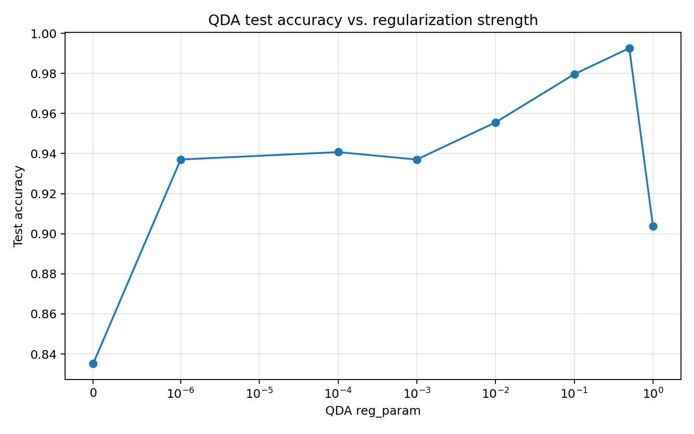
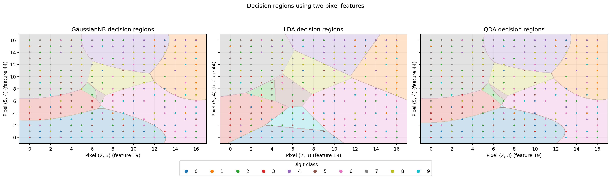

# HW01：貝氏分類器、Gaussian Naive Bayes 與模型比較

## 實驗設定

- 資料集：`sklearn.datasets.load_digits()`，共 1797 筆、64 個像素特徵、10 個類別。
- 切分：訓練集 70%、測試集 30%，`stratify=y`。
- 隨機種子：`random_state=0`。
- GaussianNB 自製實作：`var_smoothing=1e-9`。
- QDA 基準模型：`reg_param=0.01`；另掃描多組正則化強度。
- 二維特徵：像素座標 (2, 3) 與 (5, 4)，對應特徵索引 19 與 44。

## 題 1：貝氏判別函式推導

### 1.1 設定與多元高斯假設

令類別為 $\omega_i$，先驗機率為 $P(\omega_i)$，特徵向量為 $x\in\mathbb{R}^d$。假設每一類別的條件分布為多元高斯：

$$
p(x\mid\omega_i)=
\frac{1}{(2\pi)^{d/2}|\Sigma_i|^{1/2}}
\exp\left[-\frac12(x-\mu_i)^T\Sigma_i^{-1}(x-\mu_i)\right].
$$

其中 $\mu_i$ 是類別平均向量，$\Sigma_i$ 是該類別的正定共變異數矩陣。

由貝氏定理，分類時選擇後驗機率最大的類別：

$$
\hat y=\arg\max_i P(\omega_i\mid x)
=\arg\max_i P(\omega_i)p(x\mid\omega_i).
$$

等號右側省略了分母 $p(x)$，因為對固定輸入 $x$ 而言，$p(x)$ 對所有候選類別都相同，不會改變最大值所在的類別。

### 1.2 取對數並展開

因為對數函數嚴格遞增，取對數不會改變 argmax：

$$
\delta_i(x)=\ln P(\omega_i)+\ln p(x\mid\omega_i).
$$

代入高斯密度：

$$
\delta_i(x)=\ln P(\omega_i)
-\frac d2\ln(2\pi)
-\frac12\ln|\Sigma_i|
-\frac12(x-\mu_i)^T\Sigma_i^{-1}(x-\mu_i).
$$

其中 $-\frac d2\ln(2\pi)$ 對所有類別都相同，因此可從判別函式中刪除。再將整個函式乘以正數 2，也不會改變最大值所在的類別。得到等價判別函式：

$$
\boxed{
g_i(x)=
2\ln P(\omega_i)-\ln|\Sigma_i|
-(x-\mu_i)^T\Sigma_i^{-1}(x-\mu_i)
}
$$

因此：

$$
\boxed{\hat y=\arg\max_i g_i(x)}
$$

這裡保留了先驗、行列式與 Mahalanobis 距離項，因為它們都可能隨類別 $i$ 改變，不能任意刪除。

### 1.3 證明判別函式對 x 為二次函式

將二次型展開：

$$
(x-\mu_i)^T\Sigma_i^{-1}(x-\mu_i)
=x^T\Sigma_i^{-1}x
-2\mu_i^T\Sigma_i^{-1}x
+\mu_i^T\Sigma_i^{-1}\mu_i.
$$

代回 $g_i(x)$：

$$
\begin{aligned}
g_i(x)=&
-x^T\Sigma_i^{-1}x
+2\mu_i^T\Sigma_i^{-1}x\\
&-\mu_i^T\Sigma_i^{-1}\mu_i
-\ln|\Sigma_i|+2\ln P(\omega_i).
\end{aligned}
$$

其中第一項是關於 $x$ 的二次項，第二項是一次項，其餘是與 $x$ 無關的常數。因此 $g_i(x)$ 對 $x$ 是二次函式。其二次項係數矩陣為 $-\Sigma_i^{-1}$，由該類別的共變異數矩陣反矩陣決定。

比較類別 $i$ 與 $j$ 時，決策邊界滿足：

$$
g_i(x)=g_j(x).
$$

若 $\Sigma_i$ 與 $\Sigma_j$ 不同，則二次項包含：

$$
-x^T\Sigma_i^{-1}x+x^T\Sigma_j^{-1}x,
$$

一般不會互相抵消，因此邊界是一般二次曲面（在二維時為一般二次曲線）。

### 1.4 共用共變異數矩陣：LDA

若所有類別共用 $\Sigma_i=\Sigma$，則：

$$
g_i(x)=2\ln P(\omega_i)-\ln|\Sigma|
-(x-\mu_i)^T\Sigma^{-1}(x-\mu_i).
$$

展開後，$-\ln|\Sigma|$ 與 $-x^T\Sigma^{-1}x$ 對所有類別相同，可一併消去：

$$
\boxed{
g_i^{LDA}(x)=
2\ln P(\omega_i)+2\mu_i^T\Sigma^{-1}x
-\mu_i^T\Sigma^{-1}\mu_i
}
$$

此函式對 $x$ 是線性的，所以任意兩類別的決策邊界是超平面，稱為線性判別分析（LDA）。

### 1.5 對角共變異數矩陣：Gaussian NB

若每一類別的共變異數矩陣都是對角矩陣：

$$
\Sigma_i=\operatorname{diag}(\sigma_{i1}^2,\ldots,\sigma_{id}^2),
$$

則其反矩陣也是對角矩陣，且：

$$
|\Sigma_i|=\prod_{k=1}^{d}\sigma_{ik}^2.
$$

判別函式可寫成：

$$
\boxed{
g_i^{NB}(x)=2\ln P(\omega_i)
-\sum_{k=1}^{d}\ln\sigma_{ik}^2
-\sum_{k=1}^{d}\frac{(x_k-\mu_{ik})^2}{\sigma_{ik}^2}
}
$$

對角假設使非對角共變異數（不同特徵之間的交叉項）全部為零，因此沒有 $x_kx_l$（$k\ne l$）項。判別函式仍是二次函式，但二次項只沿各特徵座標軸，不含特徵間交叉項；故邊界為軸對齊的二次邊界。這就是高斯朴素貝氏的條件獨立假設。

### 1.6 小結

- 各類別使用不同 $\Sigma_i$：二次項通常不抵消，得到一般二次決策邊界（QDA）。
- 所有類別共用 $\Sigma$：共同二次項抵消，得到線性決策邊界（LDA）。
- 各類別 $\Sigma_i$ 為對角矩陣：特徵間交叉項消失，得到軸對齊的二次判別函式（Gaussian NB）。

## 題 2：從零實作高斯朴素貝氏

核心程式碼位於 `code/gaussian_nb.py`。模型對每一類別估計先驗機率、每個特徵的平均數與變異數。類別條件獨立假設下，聯合似然可拆成各特徵高斯密度的乘積；程式改在對數空間計算，將連乘轉成對數機率相加，避免許多小機率相乘造成浮點數下溢。`var_smoothing` 會依全資料中特徵的最大變異數加入小量平滑項，避免某些像素在某類別中的估計變異數為零或過小，造成除以零及數值不穩定。

## 題 3：LDA / QDA / Gaussian NB 實驗

執行 `python hw01/code/run_experiment.py` 後，將以下結果填入本節。程式會將實際數字存於 `results/`，圖表存於 `figures/`。

### 3.1 測試準確率

請依 `results/accuracy.csv` 填入：

| 模型 | 測試準確率 |
|---|---:|
| GaussianNB (scratch) | 0.8481 |
| LDA | 0.9593 |
| QDA (reg_param=0.01) | 0.9556 |

### 3.2 混淆矩陣

以下圖檔由程式自動產生：

- `figures/confusion_matrix_gaussiannb_scratch.png`
- `figures/confusion_matrix_lda.png`
- `figures/confusion_matrix_qda_reg001.png`

三張混淆矩陣的對角線都占多數，代表大部分測試樣本被正確分類。以 LDA 為例，數字 8 有 4 筆被判成 1，數字 4 有 2 筆被判成 1；數字 2 有 2 筆被判成 3。這些錯誤可能與手寫筆畫粗細、傾斜及局部像素相似有關。

### 3.3 QDA 正則化掃描

實際數值見 `results/qda_regularization.csv`。`reg_param=0`、`1e-6` 與 `1e-4` 因至少一個類別的共變異數矩陣不滿秩而無法完成 QDA 擬合；`1e-3` 的準確率為 0.9370，`0.01` 為 0.9556，`0.1` 為 0.9796，`0.5` 達到最高的 0.9926，而 `1.0` 降至 0.9037。這顯示適度正則化能改善估計穩定性，但過強的正則化會使模型失去類別差異資訊。

### 3.4 二維特徵決策區域

本實驗使用像素索引 19 與 44（座標 (2,3) 與 (5,4)），並在相同的二維訓練資料上重新訓練三個模型。三種模型形成的區域皆呈現明顯重疊，且不同模型的邊界形狀略有差異；NB 的獨立假設使邊界沿特徵軸呈現較受限制的形狀，LDA 的邊界偏線性，QDA 則可形成彎曲邊界。只用兩個像素無法充分代表整個數字的筆畫結構，因此此圖主要用來觀察模型邊界，不代表 64 維分類效能。

### 3.5 自製 GaussianNB 與 sklearn 比對

請依 `results/summary.json` 中的 `gaussian_nb_comparison` 填入：

- 自製模型測試準確率：0.84814815
- sklearn GaussianNB 測試準確率：0.84814815
- 預測類別一致率：1.00000000
- 最大對數後驗差異：約 0.00000191

兩者的估計方式與平滑設定相同時，預測應高度一致；微小差異可能來自實作細節與浮點數運算。

## 題 4：討論

請執行實驗後，將以下方括號內容換成自己的實際結果，每題維持 3–5 句。

### 4.1 哪個模型測試準確率最高？為什麼？

在三個基準模型中，LDA 的測試準確率最高，為 0.9593，略高於 QDA（reg_param=0.01）的 0.9556，Gaussian NB 則為 0.8481。LDA 假設所有類別共用共變異數矩陣，因此只需估計一個共變異數矩陣，參數量相對較少，在本資料量下較不容易因估計過多參數而過度擬合。QDA 為每個類別估計自己的共變異數矩陣，參數量較多，雖能描述更複雜的類別分布，但也更容易受到有限樣本影響。Gaussian NB 只估計對角變異數，參數量最少、估計較穩定，但忽略像素間相關性，因此本次準確率較低；值得注意的是，QDA 在正則化掃描中以 reg_param=0.5 得到 0.9926，表示正則化設定會明顯影響比較結果。

### 4.2 QDA 在 64 維下的數值問題與正則化影響

64 維 QDA 必須對每個類別估計 64×64 共變異數矩陣，並計算其反矩陣與行列式；若樣本數相對不足或特徵高度相關，矩陣可能接近奇異，造成數值不穩定。本次 `reg_param=0`、`1e-6` 與 `1e-4` 都因類別共變異數矩陣不滿秩而無法擬合，正好顯示此問題。`reg_param` 會將估計的共變異數往較穩定的尺度收縮；本次最佳值為 0.5，準確率為 0.9926，而 0.01 時為 0.9556，1.0 時又下降至 0.9037，表示適度正則化有幫助，但過強也會降低分類能力。

### 4.3 為什麼錯誤的獨立假設仍可能有不錯表現？何時可能勝過 QDA？

手寫數字的相鄰像素確實常一起變化，因此 Gaussian NB 的條件獨立假設並不完全符合資料。即使如此，NB 仍可能有不錯表現，因為分類只需要比較各類別的分數，不一定要精確還原真實的聯合機率；較少的參數也使它在有限樣本下較不容易過度擬合。當訓練資料量不足、QDA 的共變異數估計不穩定，或特徵維度相對樣本數太高時，NB 可能勝過 QDA。本次實驗中 Gaussian NB 為 0.8481、基準 QDA（reg_param=0.01）為 0.9556，因此本次資料切分下 NB 並未勝過 QDA。不過，QDA 在未正則化及極弱正則化時無法擬合，顯示當樣本不足以穩定估計完整共變異數矩陣時，NB 較少的參數可能成為優勢；若資料量更少或維度更高，NB 有機會因較低估計變異而勝過 QDA。

### 4.4 換成 MNIST（784 維）後的挑戰

MNIST 每筆資料有 784 個像素特徵，維度比本次 digits 的 64 維高很多。LDA 需要估計共用的 784×784 共變異數矩陣，計算與儲存成本都增加，而且若訓練樣本不足，估計仍可能不穩定。QDA 要為 10 個類別分別估計 784×784 矩陣，參數量與矩陣反矩陣成本大幅增加，更容易遇到奇異或近奇異問題。Gaussian NB 的計算量相對較低且只需估計每類每特徵的平均數與變異數，但仍忽略像素間大量的空間相關性，因此模型表達能力可能不足。

## 生成式 AI 使用聲明

本作業使用 OpenAI ChatGPT 協助整理實作架構、撰寫程式初稿與檢查數學推導。本人應自行執行程式、檢查輸出結果、理解程式邏輯，並依課程規定記錄 AI-Tool、AI-Prompt、AI-Reason 與 Human-Judgment。實驗數據以實際執行程式產生，不以 AI 生成或猜測的數字代替。
